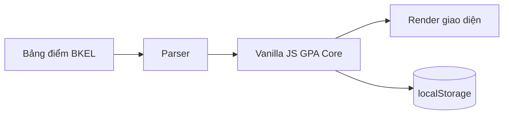

<div align="center">

<h1>GPA Calculator</h1>

<p>
  <strong>Tính GPA HCMUT nhanh từ bảng điểm BKEL.</strong><br>
  Theo dõi tiến độ, môn cải thiện và lập kế hoạch đạt GPA tốt nghiệp trong một giao diện duy nhất.
</p>

<p>
  <a href="#technology"></a>
  <a href="#deployment"></a>
  <a href="#testing"></a>
  <a href="#overview"></a>
</p>

<p>
  <strong><a href="https://gpa-calculator-2p4.pages.dev">Mở Live Demo</a></strong> ·
  <strong><a href="#quick-start">Bắt đầu nhanh</a></strong>
</p>

</div>

<p align="center">
  <a href="#overview">Tổng quan</a> •
  <a href="#features">Tính năng</a> •
  <a href="#demo">Demo</a> •
  <a href="#quick-start">Bắt đầu</a> •
  <a href="#usage">Cách dùng</a> •
  <a href="#architecture">Kiến trúc</a> •
  <a href="#project-structure">Cấu trúc</a> •
  <a href="#testing">Kiểm thử</a> •
  <a href="#deployment">Triển khai</a> •
  <a href="#contributing">Đóng góp</a> •
  <a href="#license">Giấy phép</a>
</p>

---

<a id="overview"></a>
## Tổng quan

GPA Calculator giúp sinh viên **Đại học Bách Khoa TPHCM (HCMUT)** biến bảng điểm BKEL thành một bức tranh học tập dễ hiểu. Chỉ cần sao chép bảng điểm, ứng dụng sẽ tự nhận diện học kỳ, lọc môn không tính điểm và áp dụng thang điểm HCMUT.

Không chỉ hiển thị GPA hiện tại, project còn giúp trả lời hai câu hỏi quan trọng:

- Cần đạt GPA bao nhiêu trong số tín chỉ còn lại?
- Cần cải thiện bao nhiêu tín chỉ lên A, B+ hoặc phối hợp cả hai?

> Ứng dụng HCMUT-only, không cần cấu hình thang điểm và không có bước build cho các tính năng chạy cục bộ.

<a id="features"></a>
## ✨ Tính năng

| Tính năng | Mô tả |
| --- | --- |
| 📋 **Import BKEL** | Dán bảng điểm, tự nhận họ tên, MSSV, học kỳ, môn học và lọc các dòng không tính điểm. |
| 🎯 **GPA HCMUT** | Tính GPA Hệ 4, Hệ 10, tín chỉ tích lũy và xu hướng theo học kỳ. |
| 🔄 **Môn cải thiện** | Tự phát hiện môn trùng tên và chỉ dùng lần có điểm cao nhất cho GPA tích lũy. |
| 🎓 **Mục tiêu tốt nghiệp** | Tính GPA cần đạt cho phần tín chỉ còn lại ngay khi thay đổi mục tiêu. |
| 💡 **Phương án học lại** | Gợi ý tối đa ba phương án nâng lên A, B+ hoặc phối hợp, kèm GPA tốt nghiệp tổng dự kiến. |
| ✏️ **Chỉnh sửa trực tiếp** | Thêm, sửa, xóa học kỳ và môn học; kết quả được cập nhật tức thì. |
| 💾 **Tự động lưu** | Dữ liệu được lưu trong `localStorage` và không mất khi tải lại trang. |

### Giới hạn dữ liệu

| Nguồn dữ liệu | Học kỳ tối đa | Môn mỗi học kỳ | Khi vượt giới hạn |
| --- | ---: | ---: | --- |
| Nhập tay | 12 | 12 | Không cho thêm mới |
| Import BKEL | 24 | 50 | Từ chối toàn bộ, không cắt dữ liệu |

<a id="demo"></a>
## 🖥️ Demo

Trải nghiệm phiên bản đang triển khai trên Cloudflare Pages:

### [gpa-calculator-2p4.pages.dev](https://gpa-calculator-2p4.pages.dev)

<!-- TODO: Add a desktop screenshot or short GIF here when a maintained repository asset is available. -->

<a id="quick-start"></a>
## 🚀 Bắt đầu nhanh

Không cần cài dependency hay chạy build. Trên Windows PowerShell:

```powershell
git clone https://github.com/VQ-Vinh/GPA-CALCULATOR.git
cd GPA-CALCULATOR
start index.html
```

Các tính năng GPA, chỉnh sửa và `localStorage` hoạt động ngay khi mở file trực tiếp.

<a id="usage"></a>
## Cách sử dụng

| Bước | Thao tác |
| ---: | --- |
| **1** | Mở **Bảng điểm môn học** trên BKEL, nhấn `Ctrl+A` và `Ctrl+C`. |
| **2** | Dán nội dung vào GPA Calculator, sau đó chọn **Tính GPA**. |
| **3** | Xem GPA tích lũy, xu hướng học kỳ và các môn cải thiện. |
| **4** | Nhập GPA mong muốn và GPA dự kiến cho số tín chỉ còn lại để xem phương án. |

<a id="architecture"></a>
## Kiến trúc



- **Parser:** đọc dữ liệu BKEL, nhận diện học kỳ và lọc các môn không tính điểm.
- **GPA Core:** áp dụng thang HCMUT, xử lý môn cải thiện và tính các kịch bản tốt nghiệp.
- **Frontend:** render giao diện và lưu dữ liệu trong trình duyệt.

<a id="technology"></a>
### Công nghệ

| Lớp | Công nghệ |
| --- | --- |
| Giao diện | HTML, CSS thuần, Vanilla JavaScript |
| Hosting | Cloudflare Pages |
| Lưu trữ cục bộ | Web Storage API (`localStorage`) |
| Kiểm thử | Node.js built-in test runner |

<a id="project-structure"></a>
## Cấu trúc dự án

```text
GPA-CALCULATOR/
├── css/                  # Design tokens và giao diện
├── js/                   # Parser, GPA core và rendering
├── test/                 # Regression test
├── index.html
├── package.json
└── README.md
```

<a id="testing"></a>
## 🧪 Kiểm thử

Bộ regression test không cần dependency ngoài. Trong Windows PowerShell:

```powershell
npm.cmd test
```

Bộ test bao phủ parser BKEL, giới hạn import, thang điểm HCMUT, GPA tích lũy, môn cải thiện và các phương án tốt nghiệp.

<a id="deployment"></a>
## Triển khai

Project là ứng dụng static không có bước build. Có thể deploy trực tiếp `index.html`, thư mục `css/` và `js/` lên Cloudflare Pages hoặc một static hosting tương đương.

<a id="contributing"></a>
## 🤝 Đóng góp

1. Fork repository và tạo branch theo mục đích thay đổi.
2. Giữ giao diện tiếng Việt, Vanilla JS và các contract dữ liệu hiện tại.
3. Chạy `npm.cmd test` trước khi gửi thay đổi.
4. Mở Pull Request với mô tả ngắn gọn và cách đã kiểm tra.

<a id="license"></a>
## Giấy phép

Repository hiện **chưa có file `LICENSE`**. Không nên sao chép, phân phối hoặc tái sử dụng mã nguồn ngoài phạm vi được chủ sở hữu cho phép cho đến khi project công bố giấy phép phù hợp.

---

<p align="center">
  Xây dựng cho sinh viên HCMUT muốn hiểu GPA của mình nhanh hơn.
</p>
